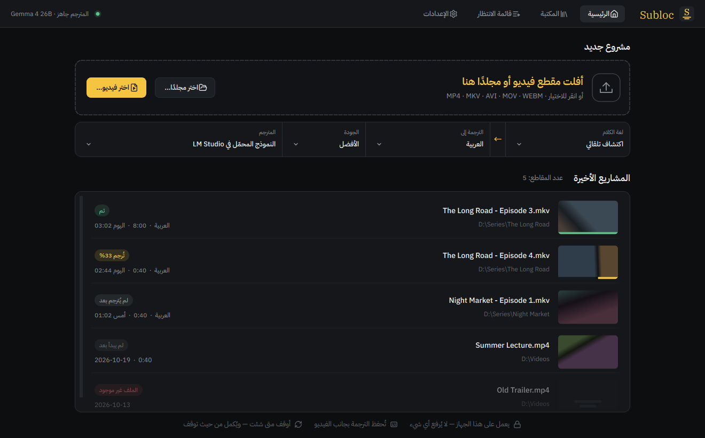
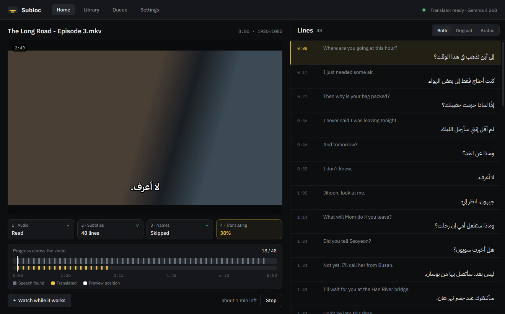
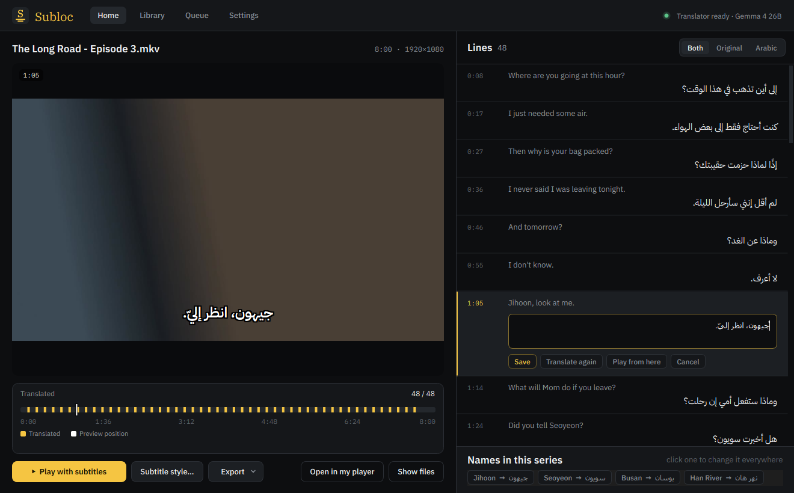
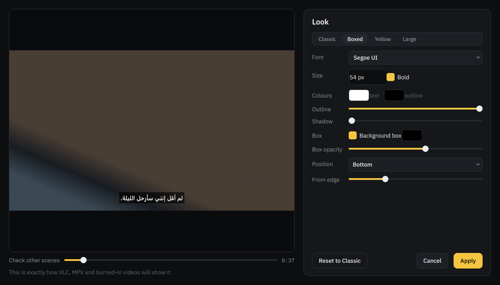
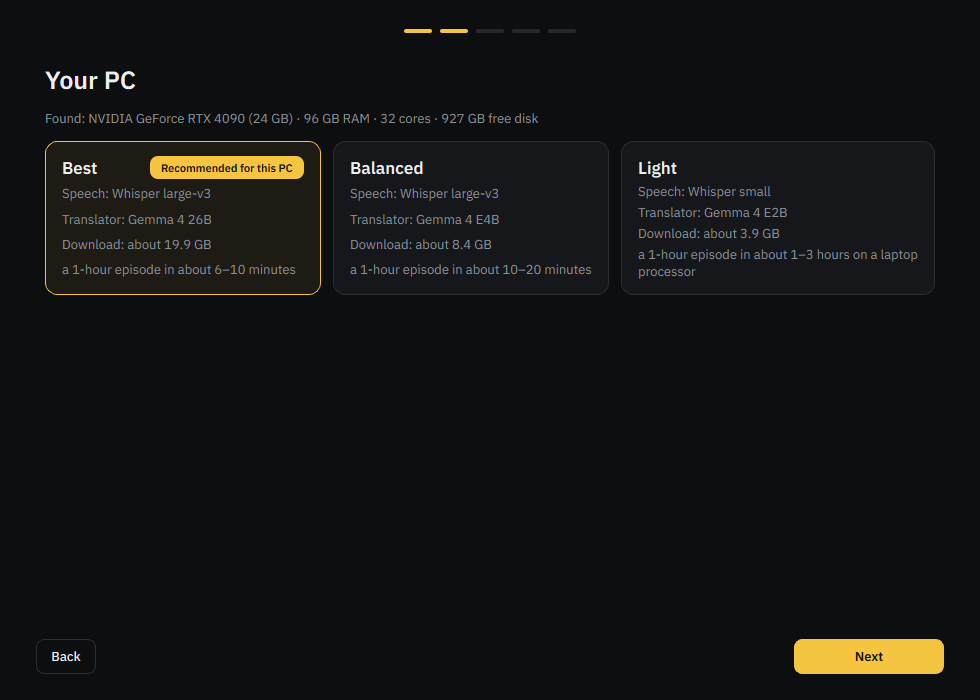
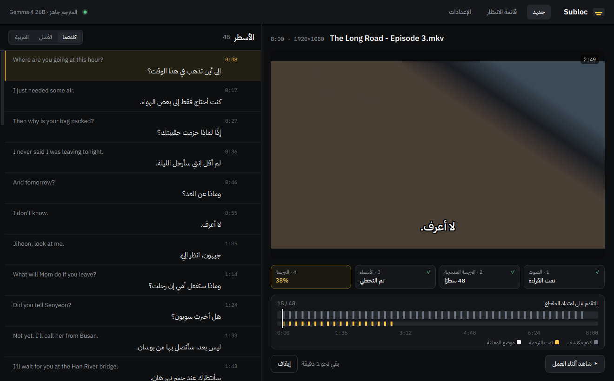

<p align="center">
  
</p>

<div dir="rtl">

# Subloc — ترجمة لأي مقطع فيديو على جهازك

**ترجمة لأي فيلم أو مسلسل أو أنمي، تُصنع على جهازك أنت.** أفلت المقطع في البرنامج، فيستمع إلى الكلام ويكتبه
ثم يترجمه إلى العربية بذكاء اصطناعي يعمل محليًا. لا يُرفع أي شيء، ولا حساب ولا اشتراك.

صُمّم أولًا للمشاهد العربي ليشاهد مسلسلاته وأفلامه والأنمي المفضلة لديه بأي لغة كانت، وبطريقة سهلة لأي شخص.

### ماذا يفعل؟

- **يستمع ويكتب:** يحوّل الكلام إلى نص بتوقيت دقيق باستخدام Whisper على بطاقة الرسوميات.
- **يترجم بفهم للسياق:** يترجم المشهد كاملًا لا السطر وحده، ويوحّد كتابة الأسماء في كل الحلقات، ولا يمسّ التوقيت أبدًا.
- **يستفيد من الترجمة الموجودة:** إن كان في الملف ترجمة (إنجليزية مثلًا) يترجمها مباشرة، فيكون أسرع وبتوقيت احترافي.
- **يتعامل مع الملفات الحقيقية:** عدة مسارات صوتية، مقاطع بلغات مختلطة، ملفات تالفة، ومجلدات مواسم كاملة.
- **تستطيع التصحيح:** انقر أي سطر لتعديله أو إعادة ترجمته، وغيّر اسم شخصية مرة واحدة فيتغيّر في كل مكان.
- **بالشكل الذي تريده:** أنماط للترجمة مع معاينة دقيقة، ومشغّل داخل البرنامج، وتصدير فيديو بترجمة مدمجة للهاتف والتلفاز.
- **بواجهة عربية كاملة** من اليمين إلى اليسار، أو بالإنجليزية.
- **من سطر الأوامر أو عبر وكيل ذكاء اصطناعي:** كل ما يفعله البرنامج متاح بالأوامر، وكخادم MCP يستطيع وكيل مثل Claude
  أن يجد المقاطع التي تنقصها ترجمة ويترجمها ويصحّحها لك، وكل ذلك على جهازك.

### الخصوصية

كل شيء يعمل على جهازك. لا تُرسل مقاطعك ولا أصواتها ولا ترجماتها إلى أي مكان. الاتصال الوحيد بالإنترنت هو تنزيل
النماذج أثناء الإعداد.

### الحالة

نسخة تجريبية لنظام ويندوز. يعمل حاليًا من الشيفرة المصدرية، والمثبّت بنقرة واحدة قادم قريبًا. طريقة التشغيل والتفاصيل
التقنية في القسم الإنجليزي أدناه.

**الرخصة:** مفتوح المصدر بموجب GPL-3.0.

</div>

---

# Subloc (English)

**Subtitles for any video, made on your own PC.** Drop in a movie, a series episode or an anime, and get
subtitles in your language — translated by AI running locally. Nothing is uploaded, no account, no
subscription.

Built first for **Arabic** viewers to watch their favorite shows, movies and anime in whatever language
they were made in — and designed so anyone can use it.

> **Status:** beta, Windows. Runs from source today; a one-click installer is next.

## What it does

- **Listens and writes** — Whisper turns the speech into timed text, on your graphics card.
- **Translates with context** — a local language model translates whole scenes, not single lines, keeps
  names spelled the same in every episode, and never touches the timing.
- **Uses existing subtitles** — if the file already has subtitles (say, English), it translates those
  instead: faster, with professional timing.
- **Handles real-world files** — several audio tracks, mixed-language videos, damaged downloads (timing
  stays right, you get a warning), whole season folders.
- **Lets you fix things** — click any line to edit it or translate it again; rename a character once and
  every line follows.
- **Looks the way you want** — subtitle styles with an exact preview; play inside the app, or burn the
  subtitles into a new video for phones and TVs.
- **Speaks your language** — English and Arabic interface (full right-to-left layout).

| Working | Reviewing |
|---|---|
|  |  |

| Subtitle style | Setup | واجهة عربية |
|---|---|---|
|  |  |  |

## How it works

```
video ─► ffmpeg ─► Whisper (speech → timed lines) ─┐
     └─► built-in subtitles (if any) ──────────────┤
                                                   ▼
          name list (one spelling per name, per series folder)
                                                   ▼
          local LLM translates numbered lines in batches, with context
          (timestamps never leave the app; each answer is checked line by line)
                                                   ▼
          Video.ar.srt  +  styled Video.ar.ass  +  optional burned-in MP4
```

The translator is either **built in** (Subloc runs [llama.cpp](https://github.com/ggml-org/llama.cpp)
with a model chosen for your PC) or **your own server** — LM Studio, Ollama or any OpenAI-compatible
address.

### Recommended setups

| Setup | For | Speech | Translator | Download |
|---|---|---|---|---|
| Best | NVIDIA, 20 GB+ | Whisper large-v3 | Gemma 4 26B | ~20 GB |
| Balanced | NVIDIA, 6–12 GB | Whisper large-v3 | Gemma 4 E4B | ~8 GB |
| Light | any PC | Whisper small | Gemma 4 E2B | ~4 GB |

On a strong GPU an 87-minute film takes about 9 minutes. The Light setup runs on the processor: it works,
but a 1-hour episode can take 1–3 hours on a laptop.

## Run from source (Windows)

Needs [ffmpeg](https://ffmpeg.org) on `PATH`, [uv](https://docs.astral.sh/uv/) and
[7-Zip](https://www.7-zip.org) (to unpack the player library).

```powershell
git clone https://github.com/FEzio78/Subloc
cd Subloc
. .\env.ps1 -Setup                         # Python 3.12 + packages, all inside this folder
.venv\Scripts\python tools\fetch_vendor.py # llama.cpp + libmpv (pinned, checksum-verified)
.\Subloc.bat                               # first launch opens Setup
```

## Command line and AI agents

Everything the app does also works without the window, with the app's settings
([docs/cli.md](docs/cli.md)):

```powershell
.venv\Scripts\python -m subloc translate "D:\Shows\Season 1"   # a whole folder, subfolders too
.venv\Scripts\python -m subloc translate "movie.mkv" --to en
.venv\Scripts\python -m subloc folder "D:\Shows" --missing     # what still needs subtitles
.venv\Scripts\python -m subloc lines "movie.mkv"               # read, then: edit / retranslate / burn
.venv\Scripts\python -m subloc --help                          # every command takes --json
```

`subloc mcp` runs Subloc as an MCP server, so an AI agent (Claude Desktop, Claude Code…) can find videos
without subtitles, make them, and fix lines for you, all still on your PC ([docs/agents.md](docs/agents.md)).

## Output

Saved next to the video, so VLC, MPV, Plex and most TVs pick the subtitles up automatically:

| File | What |
|---|---|
| `Video.ar.srt` | translated subtitles |
| `Video.ar.ass` | the same, in your chosen style (when a style is set) |
| `Video.<lang>.srt` | the original-language transcript |
| `Video.subloc.json` | saved progress — stop anytime and continue later |
| `subloc.glossary.json` | names in this folder and how they are written — edit to fix a name everywhere |

## Privacy

Everything runs on your computer. Videos, audio and subtitles are never sent anywhere. The only network
traffic is downloading models during Setup (from Hugging Face) — or talking to the translator server
*you* configure.

## Contributing

Bug reports and pull requests are welcome — see [CONTRIBUTING.md](CONTRIBUTING.md). Design notes and the
roadmap are in [PLAN.md](PLAN.md).

## License

[GPL-3.0-or-later](LICENSE), with an additional permission for NVIDIA's CUDA libraries. Third-party
components and their licences: [THIRD_PARTY_NOTICES.md](THIRD_PARTY_NOTICES.md). Fonts: IBM Plex (OFL-1.1).
